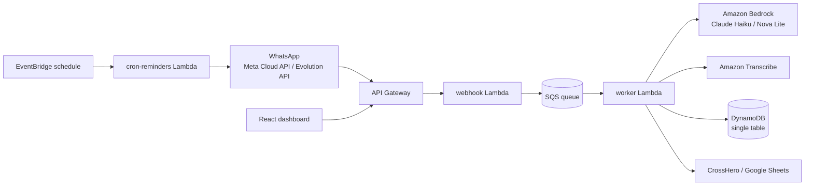

# DojoPay

Multi-tenant WhatsApp assistant for gyms and martial-arts academies. It answers students, tracks monthly payments, validates bank-transfer receipts with a vision model, and gives academy owners an admin chat for managing students, coaches and finances.

## Architecture



- **Webhook / worker split:** the webhook acknowledges Meta immediately and enqueues the payload; the worker processes it asynchronously with idempotency and message debouncing.
- **Role-aware agent:** the sender is resolved as admin, coach or student, and each role gets its own system prompt and tool set (payments, student management, reports, court bookings).
- **Tool use:** the LLM calls typed tools implemented in `tool-executor.ts` (approve payment, register student, generate Excel report, and more).
- **Single-table DynamoDB:** tenants, students, coaches, payments, conversation memory and idempotency markers share one table.
- **Secrets:** tenant credentials are encrypted with AWS KMS at rest.

## Repository layout

| Path | Description |
| --- | --- |
| `dojo-bot-saas/` | Serverless backend (TypeScript, AWS Lambda) |
| `frontend/` | Owner dashboard (React, Vite, Tailwind) |
| `landing/` | Static marketing site |

## Tech stack

TypeScript, Node.js 22, Serverless Framework, AWS Lambda, API Gateway, SQS, DynamoDB, KMS, SSM, Bedrock, Transcribe, React 19, Vite, Tailwind CSS.

## Getting started

```bash
cd dojo-bot-saas
cp .env.example .env
npm install
npm run build
npx serverless offline
```

```bash
cd frontend
cp .env.example .env
npm install
npm run dev
```

Deployment requires AWS credentials: `npm run deploy` from `dojo-bot-saas/`.
